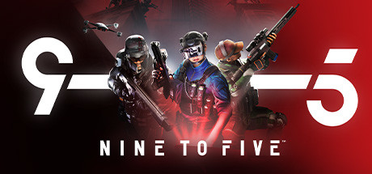

# Hugo Salin

Game developer and software engineer, working mostly in Unreal Engine and C++.

I picked up Unreal Engine in 2014 and have been writing C++ since 2017. What I enjoy most is multiplayer and networking, along with systems architecture and making sure games run fast without compromises. Outside of games I also build other software and the occasional web project.

## What I do

- Multiplayer and networking
- Gameplay programming
- Systems engineering and architecture
- Game and systems design
- Performance and optimization
- Graphics programming
- Procedural content generation
- Tools and editor extensions
- Whatever else a project needs

## What I use

| | |
|---|---|
| **Languages** | C++, C#, Python, Lua, JavaScript |
| **Web** | React, Node.js, REST APIs |
| **Version control** | Git, Perforce, Plastic SCM |
| **3D and art** | Blender, Substance Painter, Substance Designer |

## Projects

<!-- Put GIFs or screenshots in an images/ folder in this repo. Entries start expanded if they contain "open" keyword, eg. 
 -->

<b>Nine to Five</b> · Redhill Games · Junior Gameplay Programmer, 2019–2021

 

Nine to Five was a team-based multiplayer FPS. At Redhill I worked across much of the game, primarily on multiplayer gameplay programming, along with UI and animation.

`Unreal Engine` `C++` `Multiplayer` `Gameplay` `Animation` `UI`

<table>
<tr>
<th width="50%" align="left">Responsible for</th>
<th width="50%" align="left">Other work</th>
</tr>
<tr>
<td valign="top">

- Mantling
- Drone movement
- Client-side prediction for ammo count
- Off-center shooting with a screen-space reticle
- Player bots (prototype)

</td>
<td valign="top">

- Gunplay
- Performance profiling
- General gameplay features and scripting
- HUD and UI
- TPV/FPV synced animation montage queues
- Mantle related animation systems
- Ladder animation systems
- Animation Blueprint optimization and debugging

</td>
</tr>
</table>

> I worked closely with the designers to implement features, and with the animation department during 2021. I also helped onboard a new hire.

[9-5 Teaser Trailer](https://www.youtube.com/watch?v=GRqjKMdoicw)

<!--

<b>TODO: Project name</b> · TODO: one-line pitch

 

TODO: Longer description. (eg. what is it, and any difficulties or learnings.)

- TODO: Technical highlight
- TODO: Technical highlight

[Repo](TODO) · [Video](TODO)

<b>TODO: Project name</b> · TODO: one-line pitch

 

TODO: Longer description. (eg. what is it, and any difficulties or learnings.)

- TODO: Technical highlight
- TODO: Technical highlight

[Repo](TODO) · [Video](TODO)

-->

## Contact

You can reach me on [LinkedIn](https://linkedin.com/in/hugo-salin-714452184).
